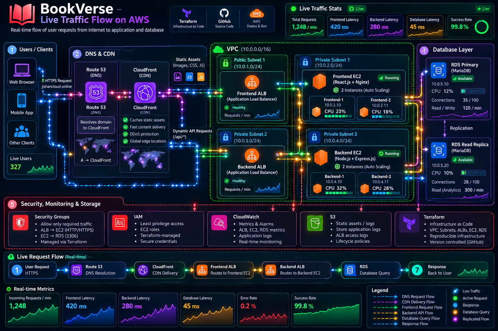
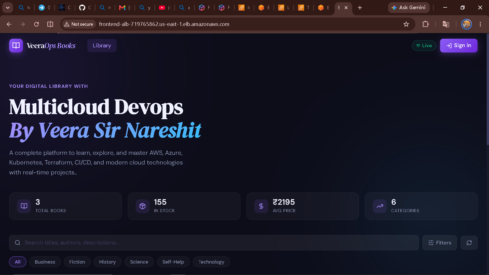

# 📚 BookVerse — AWS Infrastructure as Code with Terraform

> Automating AWS cloud infrastructure using Terraform, with a focus on modular infrastructure, network security, load balancing, and database integration.

## 📌 Project Overview

BookVerse is a cloud infrastructure and application deployment project built using **Amazon Web Services (AWS)** and **Terraform**.

The primary objective of this project is to provision and manage AWS infrastructure through Infrastructure as Code (IaC), rather than manually creating resources through the AWS Management Console.

The infrastructure configuration covers networking, compute resources, load balancing, and database provisioning. The repository also contains the BookVerse application.

This project demonstrates practical experience with Terraform modules, AWS networking, infrastructure dependencies, state management, and application deployment.

## 🎯 Project Objectives

- Automate infrastructure provisioning using Terraform.
- Design a VPC-based AWS network architecture.
- Organize infrastructure into reusable Terraform modules.
- Configure public and private networking components.
- Deploy frontend and backend compute resources.
- Configure Application Load Balancers and target groups.
- Provision Amazon RDS and a database read replica.
- Understand Terraform state management and infrastructure changes.
- Integrate application deployment with cloud infrastructure.
- Apply security and cost-management best practices.

## 🛠️ Technology Stack

| Technology | Purpose |
|---|---|
| AWS VPC | Isolated cloud networking |
| Public and Private Subnets | Network segmentation |
| Amazon EC2 | Application compute resources |
| Application Load Balancer | Application traffic distribution |
| Amazon RDS | Managed relational database |
| RDS Read Replica | Database read scaling |
| Terraform | Infrastructure as Code |
| Terraform Modules | Infrastructure organization and reusability |
| Git and GitHub | Version control and project documentation |

The exact application framework and database engine should be documented according to the implementation in this repository.

---

## 🏗️ System Architecture

The architecture diagram illustrates how the application and AWS infrastructure components interact.

<!-- Add the AWS architecture diagram here -->



### Architecture Overview

The infrastructure is organized into networking, compute, load-balancing, and database components.

**1. Networking Layer**

The VPC provides an isolated network environment for the AWS resources.

Subnets and route tables organize network connectivity, while the Internet Gateway and NAT Gateway provide internet connectivity where configured.

**2. Compute Layer**

Amazon EC2 instances host the application components.

The frontend and backend are deployed on their respective compute resources according to the project configuration.

**3. Load Balancing Layer**

Application Load Balancers distribute incoming application traffic to their configured target groups.

Health checks help determine whether registered targets are available to receive traffic.

**4. Database Layer**

Amazon RDS provides managed relational database functionality.

A read replica can support read scaling by serving eligible read queries when the application is configured to use it.

**5. Infrastructure Automation**

Terraform provisions and manages the AWS resources using configuration files and modules.

> The final architecture diagram must reflect the actual resource configuration, subnet placement, routing, and traffic flow implemented in this repository.

---

## ☁️ AWS Infrastructure Components

### Amazon VPC

Provides an isolated network environment for the project.

### Subnets and Route Tables

Organize resources into network segments and determine how traffic is routed.

### Internet Gateway and NAT Gateway

Provide internet connectivity for eligible resources according to the configured routing rules.

### Amazon EC2

Provides compute capacity for the frontend, backend, and other configured instances.

### Application Load Balancers

Distribute application traffic to configured targets using listeners, rules, and target groups.

### Amazon RDS

Provides managed relational database services for application data.

### RDS Read Replica

Provides a separate database endpoint for supported read workloads when replication is configured and the application uses the replica.

### Security Groups

Control inbound and outbound network traffic for supported AWS resources.

---

## ⚙️ Terraform Implementation

Terraform is used to define and provision the infrastructure through configuration files.

The existing project configuration includes module references for resources such as:

- VPC
- Bastion host
- Frontend EC2
- Backend EC2
- Frontend load balancer
- Backend load balancer
- RDS

Additional resources, including launch templates, should be documented according to their actual Terraform configuration.

### Terraform Workflow

The general Terraform workflow is:

**Initialize → Format → Validate → Plan → Apply**

Initialize the working directory:

```bash
terraform init
```

Format the Terraform files:

```bash
terraform fmt -recursive
```

Validate the configuration:

```bash
terraform validate
```

Review the proposed changes:

```bash
terraform plan
```

Apply the reviewed configuration:

```bash
terraform apply
```

Run these commands from the correct Terraform root directory after configuring the required providers, variables, and backend.

---

## 🔐 Terraform State Management

Terraform state records the relationship between the Terraform configuration and the infrastructure managed by Terraform.

State management is important because Terraform uses this information to determine which resources need to be created, updated, or destroyed.

### Why Is Terraform State Important?

- Tracks managed infrastructure resources.
- Helps Terraform calculate infrastructure changes.
- Maintains resource identifiers and dependencies.
- Supports consistent infrastructure management.
- Enables collaboration when a suitable shared backend is configured.

### Team Collaboration and State Locking

When multiple developers work on the same infrastructure, concurrent Terraform operations can cause conflicts.

A shared remote backend provides a common state location. State locking, when supported and configured, helps prevent multiple operations from modifying the same state simultaneously.

Recommended practices:

- Keep state files out of public Git repositories.
- Configure remote state storage where appropriate.
- Enable state locking when supported by the selected backend.
- Coordinate infrastructure changes between developers.
- Review Terraform plans before applying changes.
- Never commit AWS credentials or other secrets.

**Note:** Remote state and locking must actually be configured in the project before they can be considered implemented features.

---

## 📸 Application Screenshots

This section will showcase the actual BookVerse application.

<!-- Add screenshots of the running application below. -->

### Application Homepage



### Application Features

<!-- Add more screenshots after uploading them to the repository. -->


### Application Workflow

The screenshots demonstrate the application's user interface and implemented features.

Additional screenshots can document individual pages, functionality, and the deployed application.

---

## 📂 Repository Structure

```text
bookverse-terraform-aws/
├── ROOT/
├── application/
├── docs/
│   └── images/
│       ├── bookverse-architecture.png
│       ├── bookverse-homepage.png
│       └── bookverse-features.png
├── .gitignore
└── README.md
```

The `ROOT` and `application` directories represent the existing repository structure.

The `docs/images/` directory will contain the architecture diagram and application screenshots used in this documentation.

The exact Terraform file organization should be updated to match the actual contents of `ROOT`.

---

## 🚀 Deployment Guide

Before deploying the infrastructure, ensure that the following prerequisites are available:

- An AWS account.
- Terraform installed.
- AWS CLI installed and configured.
- Appropriate AWS IAM permissions.
- Git installed.
- Required Terraform variables and backend configuration.

### Step 1: Clone the Repository

```bash
git clone https://github.com/jishan030/bookverse-terraform-aws.git
```

### Step 2: Enter the Terraform Root Directory

Navigate to the directory containing the applicable Terraform root configuration.

The correct directory must be verified from the repository before running Terraform commands.

### Step 3: Initialize Terraform

```bash
terraform init
```

### Step 4: Validate the Configuration

```bash
terraform fmt -recursive
terraform validate
```

### Step 5: Review the Execution Plan

```bash
terraform plan
```

### Step 6: Provision Infrastructure

```bash
terraform apply
```

Review the execution plan and confirm the operation only after verifying the intended infrastructure changes.

### Step 7: Deploy and Verify the Application

Follow the application's deployment instructions and verify that the configured endpoints and application components are functioning correctly.

Application deployment steps depend on the actual implementation in the `application` directory.

---

## 🔒 Security Best Practices

- Follow the principle of least privilege for IAM permissions.
- Restrict SSH access to trusted IP addresses.
- Allow database access only from authorized security groups.
- Avoid hardcoding credentials in Terraform configuration.
- Never commit secrets or sensitive state files.
- Review security group rules before deployment.
- Monitor AWS resource usage and costs.

---

## 🧹 Infrastructure Cleanup

When the project infrastructure is no longer required, navigate to the appropriate Terraform root directory.

Review the proposed changes:

```bash
terraform plan -destroy
```

If the configuration and execution plan are correct, destroy the managed resources:

```bash
terraform destroy
```

Review the deletion plan carefully before confirming.

Resources outside the current Terraform configuration may require separate cleanup.

---

## 📈 Key Learnings

This project provides practical experience with:

- Infrastructure as Code using Terraform.
- AWS VPC and network configuration.
- EC2-based application infrastructure.
- Load balancers and target groups.
- Amazon RDS and read replica concepts.
- Terraform modules and resource dependencies.
- Terraform state management.
- Infrastructure version control using Git and GitHub.
- Cloud security and cost management.

---

## 👨‍💻 Author

**Jishan Khan**

GitHub: [jishan030](https://github.com/jishan030)

---

⭐ If you find this project useful, feel free to explore the repository.
